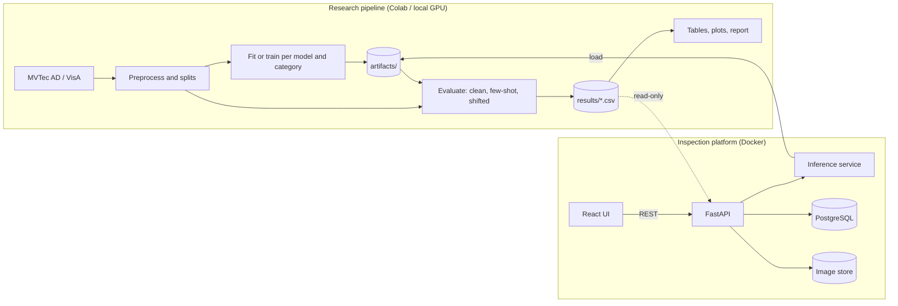
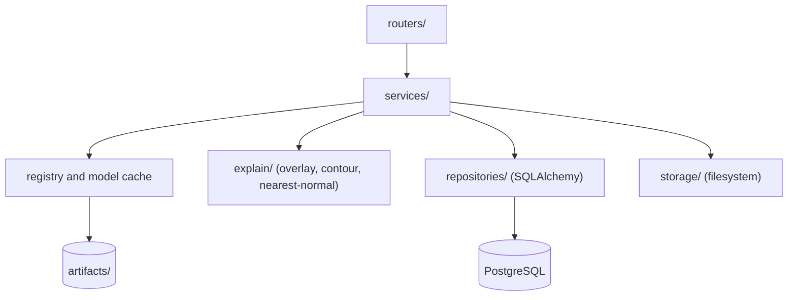
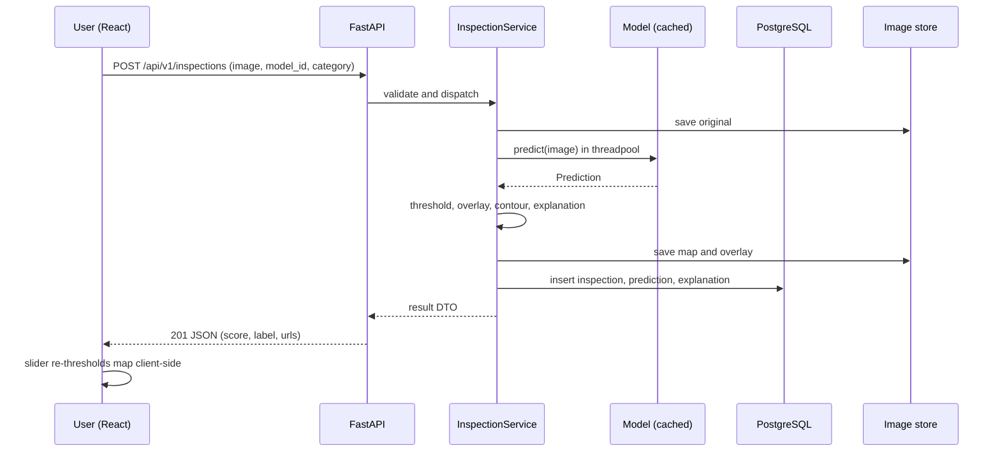
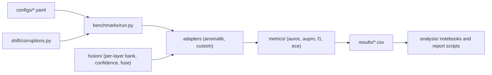

# 03. Architecture

## 1. Two systems, one repo

The **research pipeline** produces trained artifacts and result tables. The **inspection platform** serves those artifacts. They share only the artifact format and a small inference interface; the platform never imports experiment code, and experiments never need the web app.



## 2. Inference interface (the contract between both halves)

```python
class AnomalyModel(Protocol):
    name: str
    def load(self, artifact_dir: Path, device: str) -> None: ...
    def predict(self, image: np.ndarray) -> Prediction: ...

@dataclass
class Prediction:
    score: float                 # image-level anomaly score (raw)
    anomaly_map: np.ndarray      # HxW float32, raw (not normalized)
    confidence: float | None     # 0..1 if the model/fusion provides it
    scale_maps: dict[str, np.ndarray] | None   # optional per-scale maps
    latency_ms: float
    extras: dict                 # e.g. nearest-normal patch refs
```

Every model (Anomalib wrappers, custom fusion model) implements this. The backend depends only on this interface and the registry.

## 3. Backend components



- **routers:** HTTP only; validate with Pydantic, call a service, return a schema.
- **services:** orchestration (validate image, run model, thresholding, explanation, persist).
- **registry:** discovers artifacts, loads models lazily, LRU eviction.
- **explain:** pure functions on arrays; unit-testable without a server.
- **repositories:** all SQL lives here.
- **storage:** save/load images and maps; swap to object storage later without touching services.

## 4. Predict request flow



Inference is CPU/GPU bound and synchronous, so it runs in a threadpool (`run_in_threadpool`/`asyncio.to_thread`) to keep the event loop free. If this becomes a bottleneck, move to a worker process (RQ/Celery) behind the same service interface.

## 5. Research code layout and data flow



## 6. Repository layout

```
anomaly-inspect/
├── AGENTS.md
├── README.md
├── Makefile
├── docker-compose.yml
├── .env.example
├── docs/                    # this documentation set (includes figures/ and retros/)
├── notebooks/               # Colab/Kaggle setup templates (colab_setup.py)
├── scripts/                 # helper docs/scripts (e.g. download_data.md)
├── research/
│   ├── common/              # seed, io, config loading, results writer, interfaces
│   ├── data/                # dataset wrappers, split creation, few-shot sampler
│   ├── metrics/             # auroc, pixel auroc, aupro, f1max, ece, risk-coverage
│   ├── benchmarks/          # run.py, sweep orchestration, profiling
│   ├── shift/               # corruption pipeline
│   ├── fusion/              # per-layer PatchCore, confidence signals, fusion methods
│   ├── explain/             # shared explanation functions (also used by backend)
│   ├── configs/
│   └── analysis/            # notebooks, plot scripts, experiment_log.md
├── backend/
│   ├── app/ (main.py, routers/, services/, repositories/, models/, schemas/, storage/, registry.py)
│   ├── alembic/
│   ├── tests/
│   └── Dockerfile
├── frontend/
│   ├── src/ (pages/, components/, api/, hooks/)
│   └── Dockerfile
├── artifacts/               # git-ignored
├── data/                    # git-ignored
├── runs/                    # git-ignored (per-run config/env snapshots)
├── results/                 # CSVs committed (small); large outputs ignored
└── tests/                   # cross-cutting (research tests live in research/tests)
```

Shared code (`research/explain` and the `AnomalyModel`/`Prediction` interface in `research/common/interfaces.py`) is exposed via a lightweight installable core package (`pyproject.toml`) so the backend can import it without pulling in heavy experiment dependencies.

## 7. Key design principles

1. **Narrow interface** between research and platform.
2. **Config over code** for experiments; every result reproducible from a YAML and a SHA.
3. **Pure functions** for metrics, fusion, and explanations so they are testable.
4. **Fail loud on evaluation, fail safe on serving:** metrics raise on malformed input; the API returns clean errors.
5. **Images on disk, metadata in the DB.**
