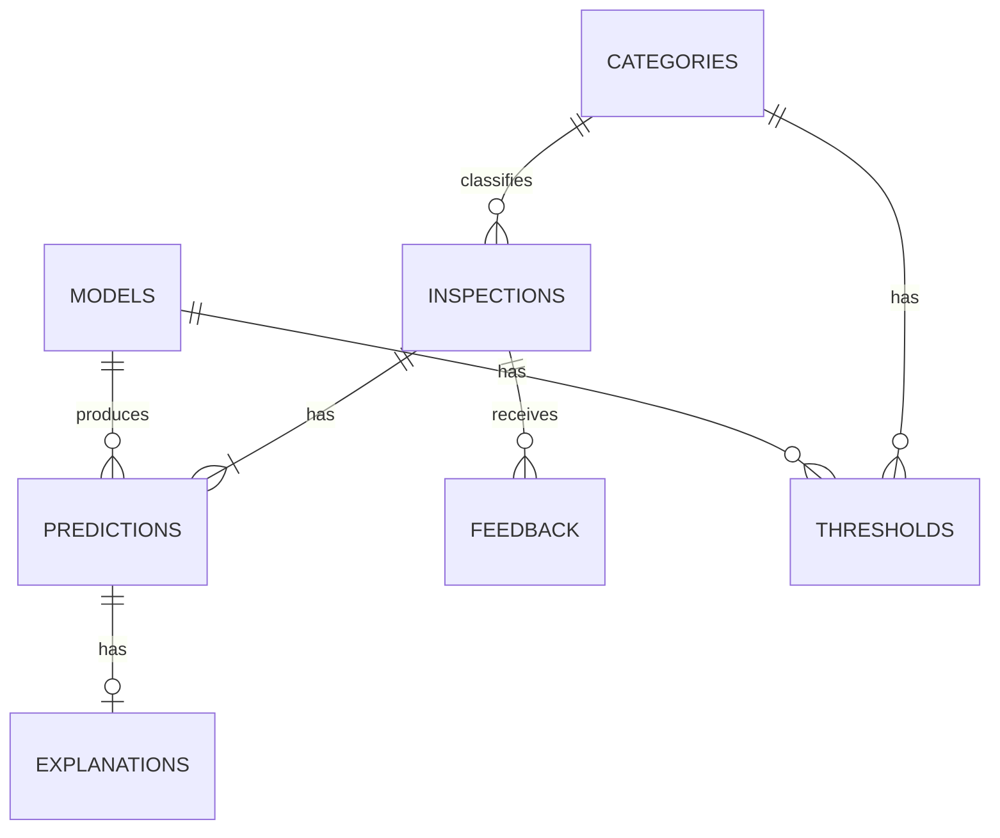

# 06. API and Data Model

Base path: `/api/v1`. JSON unless noted. All errors use `{ "error": { "code": str, "message": str } }`.

## 1. Endpoints

| Method | Path | Purpose |
|---|---|---|
| GET | `/health` | Liveness and DB check |
| GET | `/models` | Registered models with available categories, default thresholds, avg latency |
| GET | `/models/{model_id}` | One model's details |
| POST | `/inspections` | Upload image and run inference (multipart: `image`, `model_id`, `category`, optional `threshold`) |
| GET | `/inspections` | List with filters: `category`, `model_id`, `label`, `from`, `to`, `limit`, `offset` |
| GET | `/inspections/{id}` | Full detail including prediction and explanation |
| GET | `/inspections/{id}/image` | Original image |
| GET | `/inspections/{id}/map` | Anomaly map as 8-bit `image/png` (raw `map_range` is returned in JSON on `POST /inspections` and `GET /inspections/{id}`) |
| GET | `/inspections/{id}/overlay` | Heatmap overlay PNG |
| GET | `/inspections/{id}/explanation` | Nearest-normal patch references and optional text label |
| POST | `/inspections/{id}/feedback` | Body: `{ "verdict": "confirm" \| "override", "note": str? }` |
| GET | `/analytics/summary` | Totals, anomaly rate, average latency, feedback agreement |
| GET | `/analytics/anomaly-rate` | Time series; `bucket=day\|hour`, `from`, `to` |
| GET | `/analytics/score-distribution` | Histogram bins per category (filterable by `model_id`, `category`) |
| GET | `/analytics/latency-by-model` | p50/p95 per model from stored predictions |
| GET | `/benchmarks` | Parsed results from `results/results.csv` (read-only), filterable |
| PUT | `/models/{model_id}/categories/{category}/threshold` | Update default threshold (stored in DB, not artifacts) |

## 2. Key schemas (Pydantic v2)

```python
class InspectionCreateResponse(BaseModel):
    id: UUID
    model_id: str
    category: str
    score: float
    threshold: float
    label: Literal["normal", "anomalous"]
    confidence: float | None
    latency_ms: float
    map_range: tuple[float, float]      # raw min/max of the anomaly map for client re-thresholding
    image_url: str
    map_url: str
    overlay_url: str
    contour: list[list[tuple[int, int]]] | None   # polygons in image coordinates
    created_at: datetime

class Explanation(BaseModel):
    nearest_normals: list[NearestNormalRef]
    text_label: str | None
    text_label_scores: dict[str, float] | None

class NearestNormalRef(BaseModel):
    query_xywh: tuple[int, int, int, int]     # flagged patch in the query image
    reference_image_id: str                   # training image identifier
    reference_xywh: tuple[int, int, int, int]
    distance: float
    reference_url: str | None
```

Client-side re-thresholding: the map PNG is normalized 0-255 with `map_range` to recover raw values; threshold changes recompute the mask and contour in the browser (canvas) without a server call. The server-provided contour is the one for the stored default threshold.

## 3. Validation rules

- Image types: `image/png`, `image/jpeg`; verify magic bytes; max 10 MB; max 4096 px side (downscale or reject).
- `model_id` and `category` must exist in the registry; else `404`.
- Unknown form fields are ignored; extra JSON fields rejected.

## 4. Data model (PostgreSQL)



| Table | Columns (key ones) |
|---|---|
| `models` | `id` (text PK, e.g. `patchcore__mvtec`), `family`, `backbone`, `dataset`, `version`, `artifact_path`, `created_at` |
| `categories` | `id` (text PK, e.g. `bottle`), `dataset`, `display_name` |
| `thresholds` | `id`, `model_id` FK, `category_id` FK, `value` float, `method` text, `updated_at`; unique (`model_id`, `category_id`) |
| `inspections` | `id` UUID PK, `category_id` FK, `image_path`, `original_filename` (display only), `width`, `height`, `created_at` |
| `predictions` | `id` UUID PK, `inspection_id` FK, `model_id` FK, `score` float, `threshold_used` float, `label` text, `confidence` float null, `latency_ms` float, `map_path`, `overlay_path`, `map_min`, `map_max`, `contour_json` jsonb, `created_at` |
| `explanations` | `id`, `prediction_id` FK unique, `nearest_normals_json` jsonb, `text_label` text null, `text_scores_json` jsonb null |
| `feedback` | `id`, `inspection_id` FK, `verdict` text, `note` text null, `created_at` |

Indexes: `inspections(created_at)`, `predictions(model_id, created_at)`, `predictions(label)`, `inspections(category_id, created_at)`.

Design notes:
- An inspection can hold multiple predictions (run several models on one image), enabling comparison views later; the MVP creates one.
- Large blobs (images, maps) stay on the filesystem volume; the DB stores relative paths only.
- Migrations via Alembic; never edit the DB by hand. Seed `models`, `categories`, and `thresholds` from `artifacts/` on startup (idempotent).

## 5. Analytics queries (reference)

- **Anomaly rate over time:** `date_trunc(bucket, created_at)`, `avg((label = 'anomalous')::int)` over predictions.
- **Score distribution:** `width_bucket(score, min, max, n)` per category, using stored per-category validation stats for stable bin edges.
- **Latency by model:** `percentile_cont(array[0.5, 0.95]) within group (order by latency_ms)` grouped by model.
- **Feedback agreement:** share of feedback rows with `verdict = 'confirm'`.
